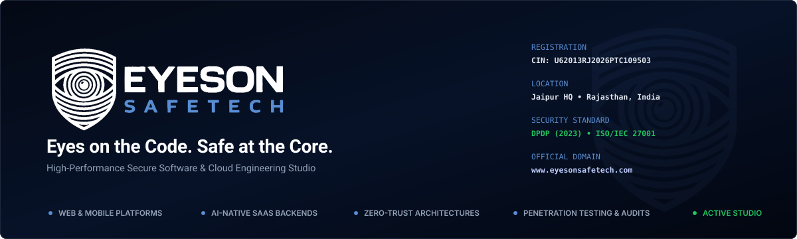
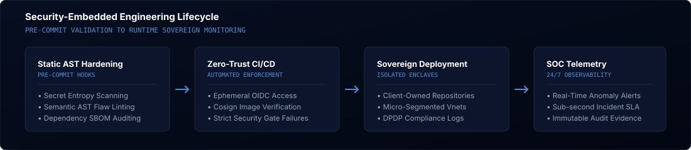
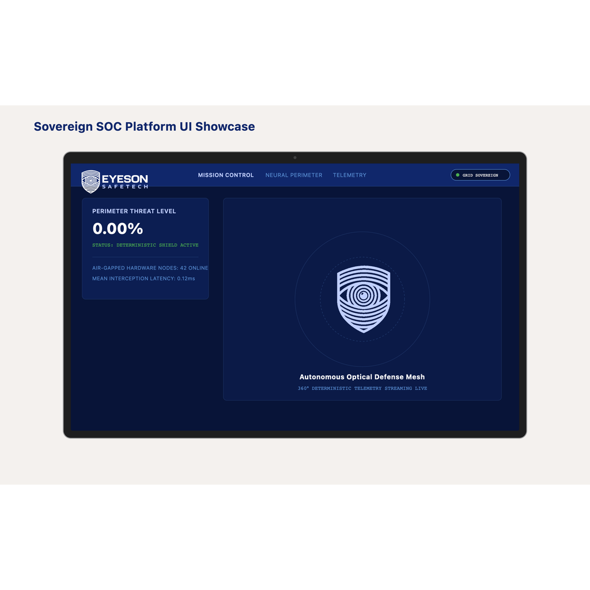
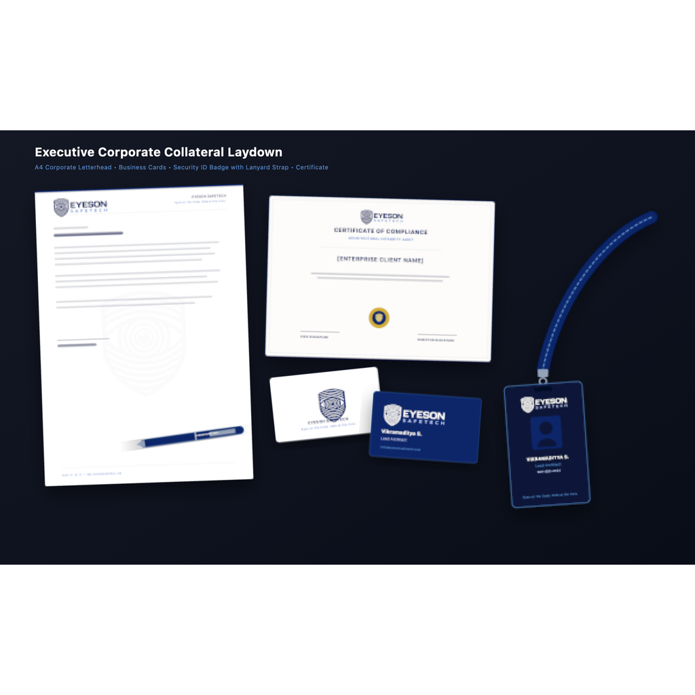
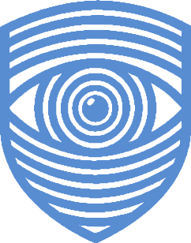

<!-- Master Hero Banner with Automatic GitHub Theme Switching -->
<div align="center">
  <picture>
    <source media="(prefers-color-scheme: dark)" srcset="./assets/banner-dark.svg">
    <source media="(prefers-color-scheme: light)" srcset="./assets/banner-light.svg">
    
  </picture>
</div>

<br/>

<div align="center">
  <a href="https://www.eyesonsafetech.com"></a>
  <a href="mailto:info@eyesonsafetech.com"></a>
  <a href="https://www.eyesonsafetech.com"></a>
  <a href="https://www.eyesonsafetech.com"></a>
</div>

<br/>

### Engineering Studio & Cybersecurity Practice

**EyesOn SafeTech Private Limited** is a high-performance software engineering studio and institutional cybersecurity practice. We solve the critical bottleneck for ambitious companies: **delivering modern digital products rapidly, while embedding zero-trust security and data sovereignty from line one.**

Most software teams force a compromise—either shipping fast while leaving critical vulnerabilities, or getting bogged down in compliance bureaucracy. EyesOn combines rapid agile product sprints with proactive penetration testing, DPDP (2023) compliance, and sovereign infrastructure ownership.

---

### Core Engineering Capabilities

* **Product Engineering (Web, Mobile & AI SaaS)**  
  High-throughput digital architectures built with modern engineering stacks (TypeScript, React, Next.js, Astro, Python, Go, and FastAPI). We engineer resilient cloud systems capable of serving enterprise scale with sub-second response times.

* **Embedded Cybersecurity & Compliance**  
  Zero-trust access verification, automated pre-commit AST linting, and institutional regulatory compliance (including the Digital Personal Data Protection Act and ISO/IEC 27001). Every deliverable undergoes rigorous vulnerability assessment and penetration testing (VA/PT).

* **High-Velocity Sprints & Sovereign Ownership**  
  Production-ready MVPs delivered within 4 to 8 weeks. All source code, cryptographic assets, and cloud repositories remain under 100% sovereign ownership of the client with zero vendor lock-in and production SLAs.

---

### Security-Embedded Engineering Lifecycle

Our development lifecycle verifies code integrity at every stage—from local workstation commits to hardened cloud runtimes:

<div align="center">
  <picture>
    <source media="(prefers-color-scheme: dark)" srcset="./assets/pipeline-dark.svg">
    <source media="(prefers-color-scheme: light)" srcset="./assets/pipeline-light.svg">
    
  </picture>
</div>

1. **Static AST Hardening:** Automated semantic linters detect secret leaks, insecure deserialization, and supply-chain vulnerabilities before commit.
2. **Zero-Trust CI/CD Automation:** Ephemeral OIDC authentication, cryptographic container image signing (Cosign), and automated compliance gates.
3. **Sovereign Cloud Enclaves:** Isolated VPC micro-segmentation, mutual TLS (mTLS), and client-controlled key management services (KMS).
4. **24/7 SOC Runtime Observability:** Real-time anomaly telemetry, sub-second error alerts, and automated immutable audit evidence.

---

### Core Technology Stack

```
Frontend & UI        │  TypeScript, React, Next.js, Astro, Tailwind CSS, Vue.js, React Native
Backend & Systems    │  Python, Go, Node.js, FastAPI, Rust, GraphQL, gRPC
Data & Caching       │  PostgreSQL, Redis, ClickHouse, MongoDB, Supabase
Cloud & DevOps       │  Docker, Kubernetes, Terraform, AWS, Google Cloud, Cloudflare Workers
Security & Vault     │  Zero-Trust (mTLS), HashiCorp Vault, WireGuard, Cosign, DPDP, ISO 27001
```

---

### Platform Operations Previews

<div align="center">
  <table>
    <tr>
      <td width="50%" align="center">
        <strong>EyesOn SOC Real-Time Security Operations Dashboard</strong><br/><br/>
        
      </td>
      <td width="50%" align="center">
        <strong>Corporate Security Credentials &amp; Collateral Suite</strong><br/><br/>
        
      </td>
    </tr>
  </table>
</div>

---

### Official Departmental Communication

For business engagements, technical consultations, or compliance inquiries, please connect directly with the designated department:

| Department | Primary Mailbox | Connected Inboxes | Function |
| :--- | :--- | :--- | :--- |
| **Customer Success** | [`support@eyesonsafetech.com`](mailto:support@eyesonsafetech.com) | `info@`, `care@`, `help@`, `service@` | General Contact, Client Helpdesk & Operations |
| **Executive & Business** | [`admin@eyesonsafetech.com`](mailto:admin@eyesonsafetech.com) | `ceo@`, `director@`, `founder@`, `inquiry@`, `leads@`, `business@` | Master Admin, ROC/Govt, Inbound Leads & B2B Deals |
| **Finance & Compliance** | [`accounts@eyesonsafetech.com`](mailto:accounts@eyesonsafetech.com) | `billing@`, `finance@`, `legal@` | GST, Invoices, Vendor payments, Contracts & Compliance |
| **Talent & People** | [`hr@eyesonsafetech.com`](mailto:hr@eyesonsafetech.com) | `careers@`, `jobs@`, `hiring@`, `talent@` | Recruitment, Resumes, Interns & Onboarding |

---

<div align="center">
  
  <br/>
  <strong>EYESON SAFETECH PRIVATE LIMITED</strong><br/>
  <em>Eyes on the Code. Safe at the Core.</em><br/>
  CIN: U62013RJ2026PTC109503 • Registered HQ: Jaipur, Rajasthan, India<br/>
  <a href="https://www.eyesonsafetech.com">www.eyesonsafetech.com</a>
  <br/><br/>
  <sub>&#169; 2026 EYESON SAFETECH PRIVATE LIMITED. ALL RIGHTS RESERVED.</sub>
</div>
