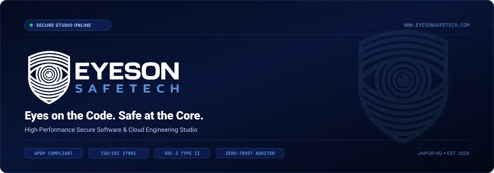
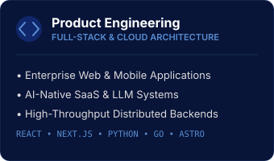
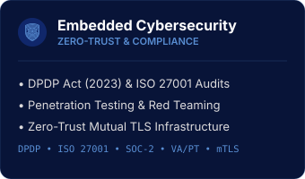
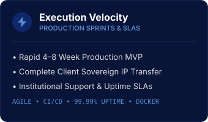
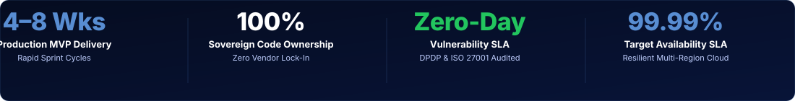
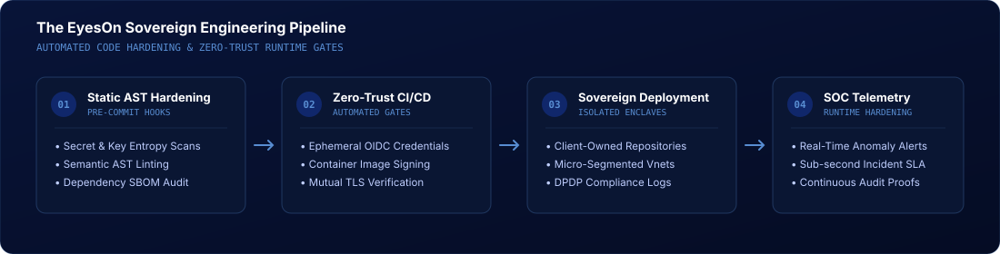

<div align="center">

  <!-- Hero Header Banner -->
  <a href="https://www.eyesonsafetech.com" target="_blank" rel="noopener noreferrer">
    
  </a>

  <br/><br/>

  <!-- Tagline -->
  <h3><em>Eyes on the Code. Safe at the Core.</em></h3>

  <p align="center">
    <strong>Enterprise Product Engineering Studio &amp; Zero-Trust Cybersecurity Practice</strong><br/>
    We solve the two critical bottlenecks for ambitious companies: building digital products users love, and protecting core assets from breaches and regulatory penalties from day one.
  </p>

  <p align="center">
    <a href="https://www.eyesonsafetech.com"></a>
    <a href="mailto:info@eyesonsafetech.com"></a>
    <a href="https://www.eyesonsafetech.com"></a>
    <a href="https://www.eyesonsafetech.com"></a>
  </p>

</div>

---

### 🛡️ About EyesOn SafeTech

**EyesOn SafeTech Private Limited** is an engineering studio founded to eliminate the divide between software development speed and institutional security. 

Modern companies often ship quickly by cutting cybersecurity corners—or slow to a crawl under compliance bureaucracy. EyesOn delivers **high-velocity execution** combined with **institutional-grade security**, ensuring that every line of code deployed is resilient, audited, and completely owned by the client.

```
       [ Client Vision ]
               │
               ▼
┌─────────────────────────────────────────────────────────────┐
│  EyesOn Engineering Studio                                  │
│  ├── Full-Stack Product Engineering (Web / Mobile / SaaS)   │
│  ├── Zero-Trust Hardening & Cryptographic CI/CD Gates       │
│  └── DPDP (2023) & ISO/IEC 27001 Regulatory Verification    │
└─────────────────────────────────────────────────────────────┘
               │
               ▼
       [ Sovereign Production Platform ]
```

---

### ⚡ Strategic Core Competencies

<div align="center">
  <table>
    <tr>
      <td width="33%" valign="top">
        
      </td>
      <td width="33%" valign="top">
        
      </td>
      <td width="33%" valign="top">
        
      </td>
    </tr>
  </table>
</div>

---

### 📊 Performance Metrics & Institutional SLAs

<div align="center">
  
</div>

- **4 to 8 Weeks Production Delivery:** Rapid architecture sprints from discovery to battle-tested MVP.
- **100% Sovereign Client Ownership:** Complete IP assignment, sovereign cloud infrastructure, and zero proprietary lock-in.
- **Zero-Day Vulnerability SLA:** Sub-second threat detection with verified DPDP Act (2023) and ISO/IEC 27001 adherence.
- **99.99% Availability Commitment:** Resilient distributed cloud architecture with multi-region failover.

---

### 🔬 Sovereign Engineering Pipeline

Our software development lifecycle embeds security testing directly into development workflows before code ever touches production:

<div align="center">
  
</div>

1. **Pre-Commit Static AST Hardening:** Automated semantic linters scan for secret leakage, insecure deserialization, and supply-chain vulnerabilities.
2. **Zero-Trust CI/CD Automation:** Ephemeral OIDC authentication, cryptographic container image signing, and policy-as-code gates.
3. **Sovereign Cloud Deployment:** Micro-segmented Virtual Private Clouds, mutual TLS (mTLS), and strict access control enclaves.
4. **24/7 SOC Telemetry:** Continuous runtime vulnerability monitoring, threat detection, and immutable compliance audit logs.

---

### 💻 Technology Stack & Infrastructure

<div align="center">

| Domain | Core Technologies & Frameworks |
| :--- | :--- |
| **Frontend & Mobile** | `TypeScript` • `React` • `Next.js` • `Astro` • `Tailwind CSS` • `React Native` • `Vue.js` |
| **Backend & Distributed Systems** | `Python` • `Go` • `Node.js` • `FastAPI` • `Rust` • `GraphQL` • `gRPC` |
| **Databases & Caching** | `PostgreSQL` • `Redis` • `ClickHouse` • `MongoDB` • `Supabase` |
| **Cloud & DevOps** | `Docker` • `Kubernetes` • `Terraform` • `AWS` • `Google Cloud` • `Cloudflare Workers` |
| **Cybersecurity & Compliance** | `Zero-Trust (mTLS)` • `DPDP Act (2023)` • `ISO/IEC 27001` • `Vault` • `WireGuard` • `SOC 2` |

</div>

---

### 🖥️ Security Operations & Platform Previews

<div align="center">
  <table>
    <tr>
      <td width="50%" align="center">
        <strong>EyesOn SOC Real-Time Security Operations Dashboard</strong><br/><br/>
        
      </td>
      <td width="50%" align="center">
        <strong>Corporate Security Credentials &amp; Collateral Suite</strong><br/><br/>
        
      </td>
    </tr>
  </table>
</div>

---

### 📬 Official Department Directory & Communication

To ensure immediate routing and enterprise confidentiality, please direct communications to the designated departmental mailbox:

| Department | Primary Mailbox | Connected Inboxes | Core Business Function |
| :--- | :--- | :--- | :--- |
| **Customer Success** | [`support@eyesonsafetech.com`](mailto:support@eyesonsafetech.com) | `info@`, `care@`, `help@`, `service@` | Website General Contact, Client Helpdesk & Operations |
| **Executive & Business** | [`admin@eyesonsafetech.com`](mailto:admin@eyesonsafetech.com) | `ceo@`, `director@`, `founder@`, `inquiry@`, `leads@`, `business@` | Master Admin, ROC/Govt, Inbound Leads & B2B Deals |
| **Finance & Compliance** | [`accounts@eyesonsafetech.com`](mailto:accounts@eyesonsafetech.com) | `billing@`, `finance@`, `legal@` | GST, Invoices, Vendor payments, CA & Legal Contracts |
| **Talent & People** | [`hr@eyesonsafetech.com`](mailto:hr@eyesonsafetech.com) | `careers@`, `jobs@`, `hiring@`, `talent@` | Recruitment, Resumes, Interns & Employee Onboarding |

---

<div align="center">

  

  <br/>

  <strong>EYESON SAFETECH PRIVATE LIMITED</strong><br/>
  <em>Eyes on the Code. Safe at the Core.</em><br/>
  CIN: U62013RJ2026PTC109503 • Registered HQ: Jaipur, Rajasthan, India<br/>
  <a href="https://www.eyesonsafetech.com">www.eyesonsafetech.com</a>

  <br/><br/>

  <sub>&#169; 2026 EYESON SAFETECH PRIVATE LIMITED. ALL RIGHTS RESERVED.</sub>

</div>
